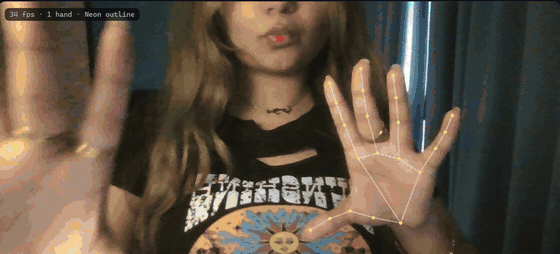
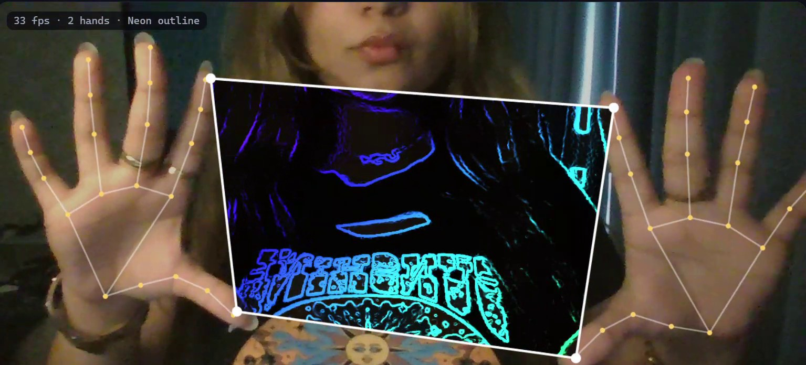

# handframe

Hold up both hands to make a frame in the air. Whatever is inside the frame gets
a live filter. It runs in the browser: there is nothing to install, and the camera
image never leaves your device.

**Live: https://tasniamoumi.github.io/handframe/** (no camera? choose "Watch the demo")



_Six of the nine filters on a laptop webcam. The dots and lines show the hand points being tracked._

## What it does

- **The frame.** Your thumb tips and index fingertips are the four corners. Move your
  hands and the frame follows, tilts and stretches.
- **Nine filters.** Sketch, pixelate, edge, invert, dual-tone, rainbow wave, glitch,
  neon outline and thermal.
- **Two modes.** *Window* filters what is behind the frame, like a lens. *Portal*
  squeezes the whole camera view into the frame with a perspective warp.
- **Hand gestures.** Middle finger to thumb changes the filter. Ring finger to thumb
  takes a photo.
- **Keyboard.** `→` `←` or `Space` change filter, `1`–`9` pick one, `M` changes mode,
  `S` takes a photo, `H` shows or hides the hand points.



_The neon outline filter._

## How it works

```
camera frame ──▶ MediaPipe hand landmarker ──▶ 21 points per hand
                                                   │
                     ┌─────────────────────────────┤
                     ▼                             ▼
          thumb + index tips              pinch distance / hand size
          → 4 corners (by screen          → "next filter", "photo"
            position), validated,           (hysteresis + cooldown)
            smoothed (One Euro filter)
                     │
                     ▼
        WebGL fragment shader: for every pixel, is it inside the quad?
        inside → run the filter (window) or map it through the inverse
        homography first (portal); outside → plain camera image
```

- **Corners are chosen by position, not by which hand is which.** The left-most hand
  gives the left corners, and on each hand the higher fingertip is the top corner. This
  keeps working when a hand is turned over or the tracker swaps its labels.
- **Smoothing.** Raw landmarks shake by a few pixels. A
  [One Euro filter](https://gery.casiez.net/1euro/) smooths each corner strongly when
  it is still and lightly when it moves fast, so the frame is steady without feeling slow.
  If a hand drops out for under a quarter of a second, the last frame is held.
- **Gestures do not depend on distance from the camera.** The gap between two
  fingertips is divided by the hand's size. A pinch fires once when the fingers close
  and cannot fire again until they open (two thresholds), with a short cooldown.
- **All filters are one shader.** Each filter is a function of a position in the camera
  image. Window mode calls it with the pixel's own position; portal mode first maps the
  pixel into the frame's 0–1 square using the inverse of a
  [square-to-quad homography](https://www.cs.cmu.edu/~ph/texfund/texfund.pdf), so one
  set of filters serves both modes.

## Run it

```bash
npm install
npm run dev        # http://localhost:5173
npm test           # 25 unit tests for the geometry, smoothing and gestures
npm run build      # static site in dist/
```

The camera needs a secure page: `localhost` or `https`.

## Project layout

```
index.html         page and controls
src/main.js        camera/demo start-up, the frame loop, controls, photos
src/tracking.js    MediaPipe hand landmarker (loaded only when the camera is used)
src/frame.js       corners, quad checks, homography, One Euro smoothing   (pure, tested)
src/gestures.js    pinch detection with hysteresis and cooldown            (pure, tested)
src/filters.js     the GLSL shaders and the filter list
src/renderer.js    WebGL drawing
src/overlay.js     frame outline and hand skeleton
src/demo.js        drawn scene and simulated hands for demo mode
tests/             Vitest unit tests
```

## Limits

- **How it was tested.** The geometry, smoothing and gesture logic have unit tests. The
  rendering, every filter, both modes, the keyboard controls and photos were checked in a
  headless browser using demo mode. Real-camera tracking was tried by hand on a
  laptop webcam (the clip above); it depends on MediaPipe and on your lighting, and has
  no automated test.
- **The hand model is downloaded from Google's model host** the first time the camera is
  used (about 8 MB), unless you put a copy at `public/models/hand_landmarker.task`.
  Without a connection to it, only demo mode works.
- Needs WebGL and a recent browser. Tracking is slower on old phones.
- Thumb-and-finger gestures move the thumb, so the frame's corner shifts a little while
  you pinch.
- Two hands only, one frame.

## Credit

The idea comes from a hand-tracking Python demo by sy4hdan on Instagram. This is a
separate implementation for the browser, written from scratch, with its own gestures,
portal mode and filters. Hand tracking is [MediaPipe](https://ai.google.dev/edge/mediapipe/solutions/vision/hand_landmarker).

## Licence

MIT
